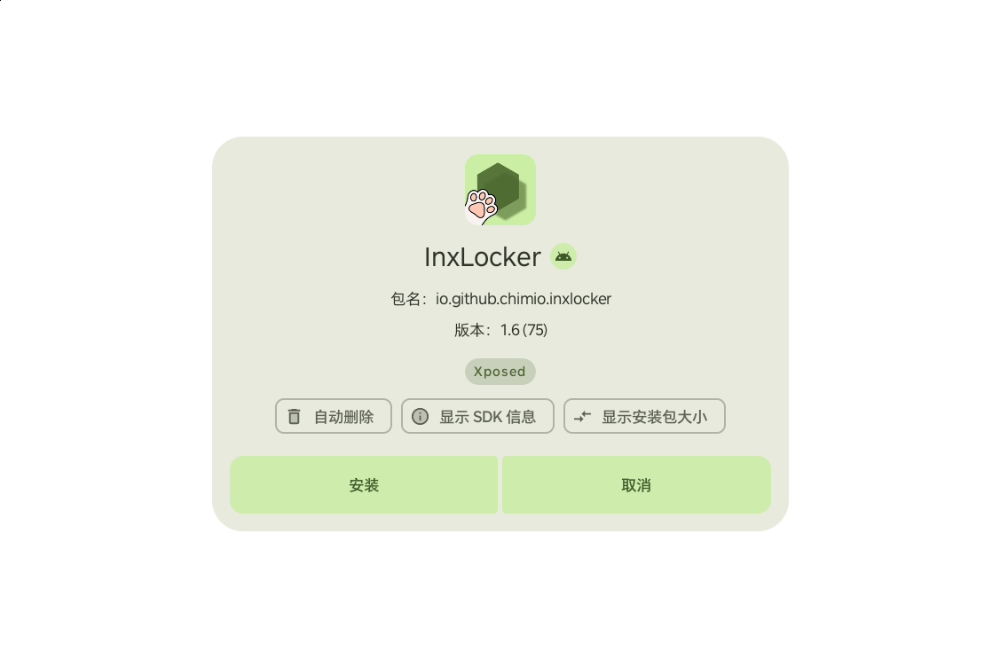

# 用 Magisk 让 InstallerX 接管 PICO 4 系统安装器

本文记录这个 fork 在 **PICO 4（A8110，Android 10 / API 29）** 上替换系统安装器的完整方法、验证结果和
已知限制。模块本体在
[`magisk/pico-system-installer`](../magisk/pico-system-installer/README.md)。

## 1. 目标

PICO 4 的 stock 安装器是 `com.android.packageinstaller`（PICO 定制版
`PicoPackageInstaller`，versionCode `100103003`）。目标是：

- 用 InstallerX PICO 接管“点 APK 安装”的流程；
- 不需要 Shizuku；
- 安装界面出现在 PICO 的近场 dock 区域，而不是一整块全屏浮窗；
- 可从 PICO 文件管理器直接点 APK 安装；
- 可回滚，不破坏 stock 安装器。

## 2. 方法总览

```text
PICO 文件管理器
  │  ACTION_VIEW
  │  data = content://media/external/file/...
  │  FilePath = /storage/emulated/0/Download/xxx.apk
  ▼
com.android.packageinstaller.InstallStart        <- activity-alias
  ▼
InstallerActivity (InstallerX PICO)
  ▼  SourceResolver 优先读取 FilePath
Root（普通安装场景）/ None（系统安装器权限）
  ▼
PackageInstaller session  ->  InstallSuccess
```

系统侧的关键不是“覆盖安装一个普通 APK”，而是：

1. **用系统安装器的包名和路径**打包/放置 APK：
   - applicationId = `com.android.packageinstaller`
   - versionCode 高于 stock（本 fork 用 `100103004`）
   - overlay 到 `/system/priv-app/PackageInstaller/PackageInstaller.apk`
2. **隐藏 stock 的同包名 APK**：
   - 用 Magisk 的 `system/priv-app/PicoPackageInstaller/.replace`
   - 在 PICO 上只提高 versionCode 不够：实测 PackageManager 仍可能先扫到 stock 并跳过重复包，
     隐藏 stock 后 InstallerX 才稳定生效。
3. **声明 AOSP 安装器的入口别名**，让系统、文件管理器、其它 App 的安装 Intent 落到 InstallerX：
   - `com.android.packageinstaller.InstallStart`
   - `com.android.packageinstaller.PackageInstallerActivity`
   - `com.android.packageinstaller.UninstallerActivity`
4. **清理一次 PackageManager 缓存**，让替换后的系统包被重新扫描。

## 3. APK 侧改动

### 3.1 身份与构建参数

- `APP_ID=com.android.packageinstaller`：构建时通过 `-PAPP_ID` 设置，
  [`app/build.gradle.kts`](../app/build.gradle.kts) 读取。
- `VERSION_CODE=100103004`：通过 `-PVERSION_CODE` 设置，必须大于当前固件 stock 的 versionCode。
- `targetSdk = 29`：PICO 4 是 Android 10；配合
  `android:requestLegacyExternalStorage="true"` 解决 PICO 文件管理器给出的 MediaStore / 文件路径
  在 scoped storage 下的读取问题。
- 默认授权方式：系统安装器场景为 `None`（系统 App 权限），普通安装场景为 `Root`；不启用 Shizuku。
  见
  [`AppSettingsRepositoryImpl.kt`](../app/src/main/java/com/rosan/installer/data/settings/repository/AppSettingsRepositoryImpl.kt)。

构建命令：

```bash
./gradlew :app:assembleUnstableDebug \
  -PAPP_ID=com.android.packageinstaller \
  -PVERSION_CODE=100103004
```

### 3.2 PICO 文件管理器：`FilePath` 优先

PICO 文件管理器发的 Intent 有两个特点：

- `data` 可能是 `content://media/external/file/<dir-id>` 这样的**目录** URI；
- 真实文件路径放在 extra `FilePath`，例如 `/storage/emulated/0/Download/app.apk`。

如果只读 `data`，会得到 `EISDIR` 或权限错误。这个 fork 在
[`SourceResolver.kt`](../app/src/main/java/com/rosan/installer/data/session/resolver/SourceResolver.kt)
中优先检查 `FilePath`，确认是文件后直接使用 `file://` URI。实测 PICO 文件管理器 Intent 可以解析并
进入 `InstallAnalysedSuccess`。

### 3.3 接管系统入口

[`AndroidManifest.xml`](../app/src/main/AndroidManifest.xml) 增加了三个 `activity-alias`，把 AOSP 安装器
的入口名指向 InstallerX 的 Activity：

```xml
<activity-alias
    android:name="com.android.packageinstaller.InstallStart"
    android:targetActivity="com.rosan.installer.ui.activity.InstallerActivity"
    android:exported="true" />
<activity-alias
    android:name="com.android.packageinstaller.PackageInstallerActivity"
    android:targetActivity="com.rosan.installer.ui.activity.InstallerActivity"
    android:exported="false" />
<activity-alias
    android:name="com.android.packageinstaller.UninstallerActivity"
    android:targetActivity="com.rosan.installer.ui.activity.UninstallerActivity"
    android:exported="true" />
```

这样系统解析 `ACTION_VIEW` / `INSTALL_PACKAGE` 时会命中 InstallerX，而不是只有从桌面启动才生效。

### 3.4 近场 dock 与安装卡片

`InstallerActivity` 声明了 PICO 的 near 元数据：

```xml
<meta-data android:name="pico.vr.position" android:value="near" />
<meta-data android:name="pvr.2dtovr.mode" android:value="6" />
```

实测结果（**不装 resfix 也成立**）：

```text
SYSTEM_EXT: add VD cache : AppRecord ... size (1127, 752), type: 2002, density: 200
```

即 PICO 给的是 `1127×752 @200` 的近场窗口（`type 2002` = dock/near）。resfix 只用于按应用微调
分辨率/DPI，不是本模块的前置条件。

安装卡片本身：

- `PositionDialog` 增加 PICO 的 `embedded` 模式，不再创建额外的 Dialog 窗口，因此没有全屏 scrim；
  卡片外区域是透明的，VR 里只看到卡片。
- 卡片最大宽度 `520dp`；在 `1127×752 @200` 下约 650px 宽，三个临时选项
  （自动删除 / 显示 SDK 信息 / 显示安装包大小）能排成一行。
- 两个操作按钮并排。
- 卡片外点击 / 返回键可以取消；逻辑与原来的 Dialog 一致。

相关代码：

- [`PositionDialog.kt`](../app/src/main/java/com/rosan/installer/ui/page/main/installer/components/PositionDialog.kt)
- [`DialogPage.kt`](../app/src/main/java/com/rosan/installer/ui/page/main/installer/dialog/DialogPage.kt)
- [`DialogButtons.kt`](../app/src/main/java/com/rosan/installer/ui/page/main/installer/dialog/DialogButtons.kt)

## 4. Magisk 模块侧

模块目录：
[`magisk/pico-system-installer`](../magisk/pico-system-installer/README.md)。

### 4.1 overlay 路径

```text
system/priv-app/PackageInstaller/PackageInstaller.apk   <- InstallerX PICO
system/priv-app/PackageInstaller/lib/.replace           <- 隐藏 stock lib
system/priv-app/PackageInstaller/oat/.replace           <- 隐藏 stock oat
system/priv-app/PicoPackageInstaller/.replace           <- 隐藏 stock 安装器
```

Magisk 在启动时把这些路径 bind mount 到 `/system`，所以是 systemless 的，卸载模块并重启即可恢复。
`lib/.replace` / `oat/.replace` 防止系统加载与旧 APK 匹配的 native lib 或 oat。

### 4.2 为什么必须隐藏 stock

实测顺序：

1. 只提高 versionCode（100103004 > 100103003）并把 APK 放进
   `/system/priv-app/PackageInstaller/`：PackageManager 仍可能使用 stock
   `PicoPackageInstaller`，日志里的实际包路径/版本没有切换。
2. 增加 `system/priv-app/PicoPackageInstaller/.replace` 后：stock 目录被隐藏；
   `dumpsys package com.android.packageinstaller` 的 `codePath` 变为
   `/system/priv-app/PackageInstaller`，versionCode 为 100103004，InstallerX 生效。

原因在于 Android 10 的 PackageManager 扫描 `priv-app` 时，遇到重复包名会按扫描顺序/优先级做取舍，
并不是简单地“versionCode 大者胜”。隐藏 stock 是最稳定的做法。

### 4.3 首次开机清缓存

`service.sh` 在模块安装/更新后的第一次开机清一次 `/data/system/package_cache/*`，并用
`$MODDIR/.cache_cleared` 标记，避免每次开机都清。`customize.sh` 会在安装时删除旧标记。

### 4.4 卸载

`uninstall.sh`：

```sh
pm clear --user 0 com.android.packageinstaller
rm -rf /data/system/package_cache/*
```

移除模块并重启后，overlay 消失，stock `PicoPackageInstaller` 恢复。

## 5. 验证记录

设备：PICO 4 `PA8110MGGB070328G`，A8110，Android 10。

```bash
# 实际生效的包
adb shell dumpsys package com.android.packageinstaller | grep -E "versionCode|versionName"
# versionCode=100103004 minSdk=26 targetSdk=29
# versionName=26.10.35d7c7a

adb shell pm path com.android.packageinstaller
# package:/system/priv-app/PackageInstaller/PackageInstaller.apk

# 近场窗口
adb logcat -d | grep -E "add VD cache.*packageinstaller"
# SYSTEM_EXT: add VD cache : AppRecord ...[size (1127, 752), type: 2002, ... density: 200]

# 实际安装
adb logcat -d | grep -E "InstallSuccess|InstallFailed"
# InstallerActivity: ... Activity collected progress: InstallSuccess
```

回滚也已实测：给模块目录加 `remove` 标记并重启后，stock 安装器恢复：

```text
codePath=/system/priv-app/PicoPackageInstaller
versionCode=100103003
package:/system/priv-app/PicoPackageInstaller/PicoPackageInstaller.apk
```

重新刷入模块并重启后，恢复为 `100103004` / `/system/priv-app/PackageInstaller`。

安装界面截图（展开三个临时选项）：



> 截图中的测试包为 InxLocker，仅用于展示布局。

## 6. 构建与打包

模块构建脚本：

```bash
bash magisk/pico-system-installer/build.sh
```

输出：

```text
magisk/pico-system-installer/dist/InstallerX-PICO-system-26.10-pico-100103004.zip
```

脚本读取 `module.prop` 的 `versionCode`，用同一个值构建 APK，避免模块与 APK 版本不一致。
`VERSION_CODE` 环境变量可以覆盖，但必须大于当前固件的 stock versionCode。

## 7. 已知限制 / 风险

- **仅验证 PICO 4 A8110 / Android 10**。其它 PICO 型号、固件的 stock 安装器路径/版本可能不同。
- **依赖系统包名和路径**：`com.android.packageinstaller` +
  `/system/priv-app/PackageInstaller`。如果 ROM 不同，需要调整 overlay 或 `.replace`。
- **升级固件后**：如果 stock 安装器的 versionCode 变大，要同步提高本模块的 versionCode，否则可能
  继续使用 stock。
- **签名**：模块默认用 debug 签名构建；系统安装器不要求与 stock 同签名（stock 已被隐藏），但自己
  重建/切换签名时可能需要清理 `com.android.packageinstaller` 数据。发布时建议维护者用固定签名构建。
- **回滚需要重启**：移除模块后 stock 安装器在重启后才恢复。
- **有变砖风险**：这是系统安装器替换操作，请先确认 Magisk 安全模式/禁用模块的方式可用。

## 8. English summary

This fork turns InstallerX Revived into the active system package installer on PICO 4 (A8110,
Android 10) without Shizuku. The APK is built with applicationId
`com.android.packageinstaller` and a versionCode higher than the stock one (`100103004` vs
`100103003`), then overlaid by a Magisk module at
`/system/priv-app/PackageInstaller/PackageInstaller.apk`. The stock `PicoPackageInstaller` is
hidden with `.replace` because raising versionCode alone was not enough on this ROM. AOSP installer
activity aliases (`InstallStart`, `PackageInstallerActivity`, `UninstallerActivity`) route system
and file-manager intents to InstallerX. `SourceResolver` prefers the PICO FileManager `FilePath`
extra over its directory-like `data` URI. The installer activity declares
`pico.vr.position=near` / `pvr.2dtovr.mode=6`, which gives a native near/dock window
(1127×752 @200) without resfix; the install UI is rendered as a compact 520dp card embedded in the
translucent activity, with the three temporary option chips fitting on one row. Uninstall the
module and reboot to restore the stock installer. GPL-3.0.
